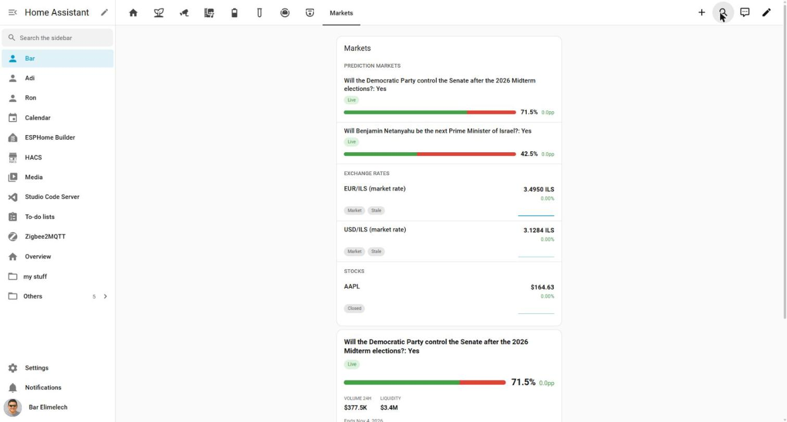
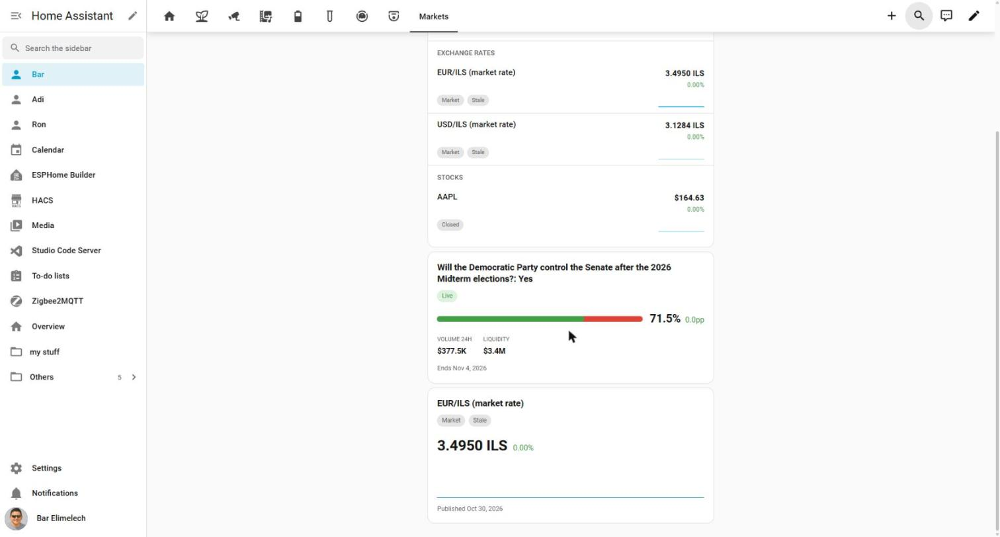
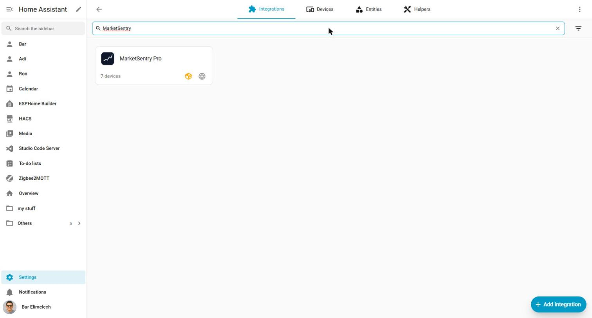

# MarketSentry Pro

MarketSentry Pro: monitor prediction markets, stocks, crypto and exchange rates in Home Assistant and automate on price changes.

> **Unofficial, not affiliated with Polymarket, Finnhub, Alpaca, CoinGecko, the Bank of Israel or any other provider.** This integration only reads public endpoints with each provider's own no-auth or free-tier access. It cannot trade, place orders, or touch a wallet or brokerage account. Each provider's terms of service (Finnhub's free tier is personal/non-commercial use only) and your local regulations apply to how you use this data.

A read-only Home Assistant integration that tracks instruments across five providers and lets your automations react to price moves, thresholds, large trades, and more.

## What it does

- **Polymarket** — prediction market outcomes. Live probability, best bid/ask, spread, last trade price, volume, liquidity, end date, and resolution status, pushed over Polymarket's WebSocket feed.
- **Finnhub** — US stocks (free tier, personal/non-commercial use, your own API key). Live trades over WebSocket.
- **Alpaca** — US stocks via the free IEX feed (optional, your own API key pair). IEX prices only, not the consolidated tape.
- **CoinGecko** — cryptocurrencies, priced in USD (free tier, no key). REST poll only, same cadence as FX.
- **FX** — exchange rates from Frankfurter or VATComply (market mid-rate, no key, two independent sources for redundancy) or the Bank of Israel's official daily representative rate (שער יציג, no key).
- Every REST-polling provider's prices refresh at least every 5 minutes regardless of streaming state, so sensors stay current even if a WebSocket connection drops.
- Fires HA events and UI-configurable device triggers per instrument kind: `threshold_crossed`, `price_move`, `daily_change` (stocks/crypto/FX), `large_trade` (Polymarket/stocks), `volume_spike`/`closing_soon`/`resolved` (Polymarket), `market_open_gap` (stocks), `official_rate_published` (FX, Bank of Israel source).
- Services for price history lookups and instrument search, usable from scripts, automations, or the Assist API for LLM tooling.

## Screenshots

| List card (grouped by kind) | Instrument detail cards | Integration icon |
| --- | --- | --- |
|  |  |  |

## Installation (HACS)

1. HACS > Integrations > search for "MarketSentry Pro" (or add this repository as a custom repository).
2. Install, then restart Home Assistant.
3. Settings > Devices & services > Add integration > "MarketSentry Pro".

## Setting up a provider account and tracked instruments

One config entry = one provider account. Credentials (if the provider needs any) are entered once; instruments are added afterward as **subentries** under that entry, so adding/removing an instrument never re-asks for a key.

1. **Add integration > MarketSentry Pro**, pick a provider: Polymarket, Finnhub, Alpaca, CoinGecko (crypto), or Exchange rates.
2. Polymarket, CoinGecko and Exchange rates need no credentials. Finnhub needs an API key; Alpaca needs a key ID + secret (and a feed choice, default `iex`). Credentials are validated live.
3. On the new entry's page, use **Add instrument** (a subentry) and paste:
   - a Polymarket URL/slug (`polymarket.com/event/...` or `/market/...`), or free text to search,
   - a stock ticker (Finnhub/Alpaca), or free text to search (Finnhub only — Alpaca has no search, paste an exact ticker),
   - a CoinGecko coin id (e.g. `bitcoin`), or free text to search (e.g. `btc` or `bitcoin`),
   - an FX pair like `EUR/ILS` (Frankfurter market rate), `EUR/ILS/boi` (Bank of Israel official rate), or `EUR/ILS/vatcomply` (VATComply market rate, a second market-rate source for redundancy).
4. If a Polymarket market has multiple outcomes or a search returns several matches, pick one; run **Add instrument** again for any others.
5. Confirm and set per-instrument thresholds, move/daily-change sensitivity, large-trade size, cooldown, etc. (defaults are sensible per kind). Edit them later via the subentry's **Reconfigure**.

Each instrument becomes its own device with its own entities and its own device triggers (the trigger list shown in the UI matches what that instrument's kind can actually fire).

## Example automations

**Notify when a Polymarket outcome crosses 60%:**

```yaml
automation:
  - alias: "Notify when Yes crosses 60%"
    trigger:
      - platform: event
        event_type: marketsentry_threshold_crossed
        event_data:
          symbol: "Yes"
          direction: up
    action:
      - service: notify.mobile_app
        data:
          message: "{{ trigger.event.data.name }} just crossed a threshold"
```

**TTS when a stock moves fast during market hours:**

```yaml
automation:
  - alias: "NVDA fast move"
    trigger:
      - platform: event
        event_type: marketsentry_price_move
        event_data:
          symbol: "NVDA"
    action:
      - service: tts.speak
        data:
          entity_id: tts.home_assistant_cloud
          media_player_entity_id: media_player.kitchen
          message: "NVDA moved {{ trigger.event.data.change_pct | round(1) }} percent"
```

**Notify when the Bank of Israel publishes a new EUR/ILS rate above a level:**

```yaml
automation:
  - alias: "EUR/ILS official rate published"
    trigger:
      - platform: event
        event_type: marketsentry_official_rate_published
    condition:
      - condition: template
        value_template: "{{ trigger.event.data.new > 4.10 }}"
    action:
      - service: notify.mobile_app
        data:
          message: "EUR/ILS official rate: {{ trigger.event.data.new }}"
```

**Flash a light when a Polymarket market resolves:**

```yaml
automation:
  - alias: "Flash light when a tracked market resolves"
    trigger:
      - platform: event
        event_type: marketsentry_resolved
    action:
      - service: light.turn_on
        target:
          entity_id: light.office
        data:
          flash: long
          color_name: green
```

You can also build these as device triggers in the UI without writing YAML — each instrument's device lists only the trigger types that apply to its kind.

### Ready-made blueprints

No YAML needed — import one of these and fill in the blanks from the UI:

- [**Notify on any event**](https://my.home-assistant.io/redirect/blueprint_import/?blueprint_url=https%3A%2F%2Fgithub.com%2Fbareli%2FMarketSentry-Pro%2Fblob%2Fmaster%2Fblueprints%2Fautomation%2Fmarketsentry%2Fnotify_on_event.yaml) - pick any MarketSentry Pro device trigger and any notification action; the trigger's full event data is available in your action as `{{ trigger.event.data }}`. Optionally also send an actionable mobile-app notification with an "Open dashboard" button and a "Snooze" button (both off by default).
- [**Announce a resolved Polymarket outcome**](https://my.home-assistant.io/redirect/blueprint_import/?blueprint_url=https%3A%2F%2Fgithub.com%2Fbareli%2FMarketSentry-Pro%2Fblob%2Fmaster%2Fblueprints%2Fautomation%2Fmarketsentry%2Fresolved_announce.yaml) - flash a light and/or speak the result when a tracked outcome resolves. Same optional actionable-notification buttons as above.
- [**Daily digest**](https://my.home-assistant.io/redirect/blueprint_import/?blueprint_url=https%3A%2F%2Fgithub.com%2Fbareli%2FMarketSentry-Pro%2Fblob%2Fmaster%2Fblueprints%2Fautomation%2Fmarketsentry%2Fdaily_digest.yaml) - one consolidated notification per day listing every tracked instrument's current value, instead of per-event alerts.

Or browse the raw files in [`blueprints/automation/marketsentry/`](blueprints/automation/marketsentry/) and import manually via Settings > Automations & scenes > Blueprints > Import blueprint.

## The marketsentry-card dashboard card

Installed and registered automatically — add it to any dashboard like any other card:

```yaml
type: custom:marketsentry-card
title: Markets
group_by: kind        # none | provider | kind
kinds:                 # omit to show every tracked instrument
  - outcome
  - stock
  - fx
```

One row per tracked instrument: live value, a sparkline, a status badge
(Live/Closing soon/Closed/Resolved for outcomes, Open/Closed for stocks,
Updated today/Stale for FX), and a link out where one exists (Polymarket,
stock provider page; none for FX). Configurable via the UI editor too.

## Auto-dashboard view (no manual card placement)

Add a new view to any dashboard and set it to generate itself instead of
hand-placing cards: edit the dashboard (pencil icon) > Add view > switch
the view to YAML mode (3-dot menu) and set it to:

```yaml
strategy:
  type: custom:marketsentry
  # title: My Markets      # optional, defaults to "Markets"
  # group_by: kind         # optional: none | provider | kind
  # kinds: [stock]         # optional filter; omit to include everything
```

The view fills itself with the `marketsentry-card` overview plus one
`marketsentry-instrument-card` per tracked instrument, and reflects
instruments you add or remove the next time the view loads - no manual
card placement, ever.

## Services

- `marketsentry.get_price_history` — historical price points for one tracked instrument (device, hours). Returns response data.
- `marketsentry.refresh` — force an immediate price refresh for a tracked instrument's provider account.
- `marketsentry.search_instruments` — search a provider by free text (provider, query, limit). Returns response data; usable from Assist/LLM tooling.

## Languages

The backend (config flow, entities, device triggers, services) and the
`marketsentry-card`/`marketsentry-instrument-card` frontend are both
translated into English, Hebrew, German, French, Spanish, Portuguese
(Brazil), Italian and Dutch, following Home Assistant's own UI language
setting. The card falls back to the closest supported base language (e.g.
`de-AT` → `de`) and then to English for anything unsupported.

## Diagnostics

Each config entry exposes a diagnostics download (Settings > Devices & services > MarketSentry Pro > entry > Download diagnostics) with provider/stream connection state and per-instrument quote state. Finnhub/Alpaca credentials in the entry's stored data are redacted; every price endpoint (including CoinGecko's) itself is public.

## Limitations

- Read-only by design. No trading, no wallet/brokerage integration, no order placement.
- Streaming connection health is tracked per provider account. Each of Finnhub/Alpaca's `stream()` loops reports its real connection phase (connecting/connected/reconnecting/backing off) as it happens; the "stream connected" binary sensor reflects that live state (on only once actually connected) and exposes `reconnecting`/`reconnect_count` attributes for the finer-grained detail (ENH-007).
- Some external API facts (noted per-provider below) weren't independently verified against live docs in this project's sessions; verify before relying on them in production.

## Development

```bash
pip install -r requirements_test.txt
ruff check custom_components/marketsentry
mypy custom_components/marketsentry
pytest tests
```

Config-flow and subentry-flow tests need the full `hass` test fixture
(`pytest-homeassistant-custom-component`), which imports `homeassistant.runner`
→ the POSIX-only `fcntl` module — they run in CI (Linux) but not natively on
Windows. Everything else (`detector`, `models`, `api`, `ws`, `market_calendar`,
all four `providers/*`) is plain Python/aiohttp and runs anywhere:

```bash
pytest tests --ignore=tests/config_flow -p no:homeassistant
```

## Build status / what to verify before production use

**Landed and wired into HA:** the `Provider` interface and all four
providers (`providers/base.py`, `polymarket.py`, `finnhub.py`, `alpaca.py`,
`fx.py`); a generalized `detector.py` (percent vs. percentage-point
`price_move`, `DailyChangeDetector`, `MarketOpenGapDetector`,
`OfficialRatePublishedDetector`); `market_calendar.py` (NYSE/NASDAQ session
state, bundled 2025-2027 holiday table); the config flow (provider +
credentials) and instrument config *subentries* (add/search/confirm/
reconfigure); the generic `ProviderSnapshotCoordinator` + streaming glue in
`__init__.py`; kind-conditional `sensor`/`binary_sensor`/`event` platforms;
`device_trigger.py`; `services.py`; en/he translations. 98 unit tests pass;
ruff and mypy --strict are clean. The subentry-based config flow itself
(the part needing the full `hass` fixture) is written against this
session's installed Home Assistant 2026.2.3 and verified by directly
inspecting that package's real APIs (`ConfigSubentryFlow`,
`AddConfigEntryEntitiesCallback`, `DeviceEntry.config_entries_subentries`)
rather than guessed, but hasn't been smoke-tested against a running HA
instance.

**Also landed:** the `marketsentry-card` frontend (vanilla Web Component,
no framework dependency, bundled with esbuild — see `card/README.md`).
Rows for every tracked instrument across providers, grouped/filterable by
provider or kind, kind-appropriate formatting, status badges, market-state/
source chips, sparklines (via a new `marketsentry/history` WS command
backed by an in-memory ring buffer, `history.py`), link-out, and a visual
editor. The Python backend auto-registers it as a Lovelace resource on
startup — nothing for the end user to add manually. 36 Vitest unit tests
and 5 Playwright tests (light/dark/RTL screenshots + behavioral checks)
pass, run live in a real headless Chromium this session. Not wired into
the Python CI workflow (separate `card-ci.yml`, Vitest only — Playwright
needs a browser download, see `card/README.md` for known gaps).

**API facts, verification status per provider** (ENH-008, 2026-10-31, confirmed what could be
confirmed without an owner account on a third-party service):
- Frankfurter: **confirmed live.** Base URL `api.frankfurter.dev/v1` is correct and canonical
  (the older `.app` domain 301-redirects to it); `base`/`symbols` params and the response shape
  all confirmed against real calls.
- Bank of Israel: **confirmed live.** The `RER_<CCY>_ILS` series-key convention is correct; the
  `c[DATA_TYPE]=OF00` filter this code used to send turned out unnecessary (every row in the
  series is already representative-rate data) and was removed. `fetch_history` for this source
  is now implemented, using the confirmed standard SDMX `startPeriod`/`endPeriod` params.
- VATComply (ENH-018, 2026-11-01): **confirmed live.** `api.vatcomply.com/rates` (no key, 2 req/s
  per IP) accepts `base`/`symbols`/`date` params and returns the same `date`/`base`/`rates` shape
  as Frankfurter; confirmed against a live call for both the latest rate and a specific historical
  date. It has no start/end range param - a tried `start_date`/`end_date` pair was silently
  ignored - so `fetch_history` for this source issues one request per day in range instead of a
  single ranged call.
- Alpaca: the WS feed path (`iex`/`sip`) and sandbox URL are now confirmed via Alpaca's own docs.
  The REST historical-bars endpoint turned out **wrong** - the real endpoint is the multi-symbol
  `/v2/stocks/bars` (a `symbols` query param, not a path segment) with bars nested under
  `{"bars": {"<symbol>": [...]}}`, not `/v2/stocks/{symbol}/bars` returning a flat list; this
  would have thrown at runtime (iterating dict keys as bar objects) and is now fixed. Trade
  message field names and the free-tier WS symbol limit remain unconfirmed (no trade-message
  example exists in Alpaca's own current streaming-market-data docs).
- Finnhub: still unconfirmed by a live call - no API key available this session, Finnhub's
  published "demo" token no longer works, and this agent won't create an account on the owner's
  behalf. The documented WS/REST shapes are corroborated against independent, actively-maintained
  third-party sources (a real consumer project's message schema, a maintained API client's
  response model) that match this file's assumptions exactly, which is a secondary-source match,
  not a live Finnhub response - get a free key and verify directly before relying on it in
  production.
- CoinGecko: the free `/search`, `/coins/{id}`, `/simple/price`, and
  `/coins/{id}/market_chart` endpoints and their response shapes — built
  against CoinGecko's long-documented public v3 contract, not a live test
  call this session.
- The `custom:marketsentry` dashboard view strategy (`ll-strategy-view-marketsentry`):
  built against the documented HA view-strategy contract
  (`static generate(config, hass)` on a custom element named
  `ll-strategy-view-<type>`) and covered by a unit test of its card-building
  logic, but not smoke-tested against a running HA frontend's actual
  strategy-resolution wiring in this project.
