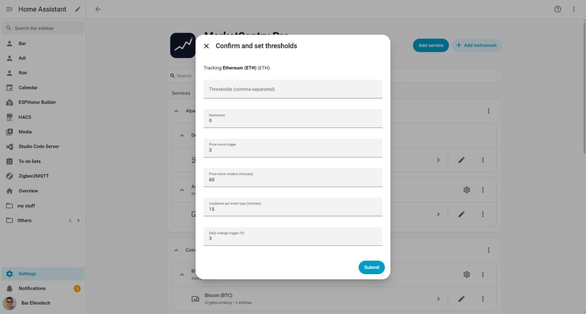

# BUG-001 Instrument confirm dialog shows the coin symbol twice for crypto instruments

| | |
|---|---|
| Type | BUG |
| Severity | LOW |
| Status | VERIFIED, closed [#1](https://github.com/bareli/MarketSentry-Pro/issues/1) |
| Issue | [#1](https://github.com/bareli/MarketSentry-Pro/issues/1) |
| Feature | Config flow - add-instrument confirm step (CoinGecko/crypto) |
| Test case | CFG-07 (extends; add a crypto-specific sub-case) |
| Environment | live (`http://homeassistant.local:8123`) |
| Branch / commit | master @ 5d113f0 |
| Detected by | qa-manager (live smoke-verification pass during v0.5.0 release) |
| Detected | 2026-10-31 |

## Summary

Adding a CoinGecko/crypto instrument, the "Confirm and set thresholds" step's description reads
**"Tracking Bitcoin (BTC) (BTC)."** - the coin's symbol appears twice. Reproduced with a second,
unrelated coin (Ethereum) with the same shape: **"Tracking Ethereum (ETH) (ETH)."** - confirms this
is systematic to every crypto instrument, not a one-off for Bitcoin. Cosmetic only: the stored
device/entity names are correct ("Bitcoin (BTC)", not duplicated) - only this one dialog's
description text is affected.

## Steps to reproduce

1. On a live HA instance with MarketSentry Pro installed, Settings > Devices & services >
   MarketSentry Pro.
2. If no CoinGecko (crypto) service exists yet, **Add service** > CoinGecko (crypto) > Submit.
3. **Add instrument** > CoinGecko (crypto).
4. Enter any valid CoinGecko coin id or free-text name, e.g. `bitcoin` or `ethereum`.
5. Submit. Read the "Confirm and set thresholds" dialog's first line.

## Expected

"Tracking **Bitcoin** (BTC)." - name and symbol shown once each, matching the confirm-step
template's intent (`config_flow.py`'s `STEP_CONFIRM_SCHEMA`/translation string:
`"Tracking **{name}** ({symbol})."`, which assumes `name` does not already contain the symbol -
true for every other provider (Polymarket market names, stock company names, FX pair names don't
embed their own symbol in parentheses).

## Actual

"Tracking **Bitcoin (BTC)** (BTC)." - the symbol appears twice.

## Evidence

Screenshot captured live against `http://homeassistant.local:8123`, reproduced a second time with
Ethereum (not committed as a second screenshot - the Bitcoin one is representative and the dialog
layout/text is identical, only the coin name/symbol differ).

## Likely root cause

`custom_components/marketsentry/providers/crypto.py`'s `_ref_from_coin()` builds the instrument's
`name` as `f"{coin['name']} ({symbol})"` (e.g. `"Bitcoin (BTC)"`), already embedding the symbol.
`config_flow.py`'s confirm-step description template is `"Tracking **{name}** ({symbol})."`,
which appends `({symbol})` again unconditionally - correct for every other provider (whose
`InstrumentRef.name` is just the plain display name with no symbol baked in), wrong for crypto's.
Confirmed by reading both files; not yet confirmed by a passing/failing unit test (none exists
for the confirm-step description string specifically - see *Regression test*).

## Relevant files

- `custom_components/marketsentry/providers/crypto.py` (`_ref_from_coin`, the `name` format)
- `custom_components/marketsentry/config_flow.py` (`InstrumentSubentryFlow.async_step_confirm`,
  the `description_placeholders={"name": ref.name, "symbol": ref.symbol}` and the translation
  string `config_subentries.instrument.step.confirm.description` in
  `custom_components/marketsentry/translations/en.json` + all 7 other language files, which all
  carry the same `"Tracking **{name}** ({symbol})."` shape and would all show the same
  duplication for crypto once translated).

## Recommended remediation

Pick one (either closes it for every language without a second edit per translation file):

1. In `crypto.py`'s `_ref_from_coin()`, set `name=coin["name"]` (plain, e.g. `"Bitcoin"`) instead
   of baking the symbol in - `ref.symbol` already carries `"BTC"` separately, and every renderer
   that shows the instrument elsewhere (device name, card row name) would then read "Bitcoin"
   instead of "Bitcoin (BTC)", which is arguably *more* consistent with how Polymarket/stock/FX
   instrument names already read elsewhere in the app (plain name, symbol shown separately in
   its own UI element/column).
2. Keep `crypto.py` as-is (symbol embedded in `name`, so the device/entity name stays
   "Bitcoin (BTC)") and fix only the confirm-step template to not re-append `({symbol})` when the
   provider is crypto - more surgical but needs a per-kind branch in `config_flow.py` and doesn't
   fix the same duplication if `name` is ever shown with `({symbol})` elsewhere in the future.

Option 1 is simpler, touches one file, and makes crypto's `InstrumentRef.name` consistent with
every other provider's "name does not already contain the symbol" convention - recommended.

## Regression test

None exists yet. Add one to `tests/config_flow/test_config_flow.py` (CI-only, Linux - see
`qa/CLAUDE.md` §1) asserting the confirm step's `description_placeholders["name"]` does not
already contain `description_placeholders["symbol"]` for a CoinGecko-resolved instrument. New
test case ID: **CFG-15**.
