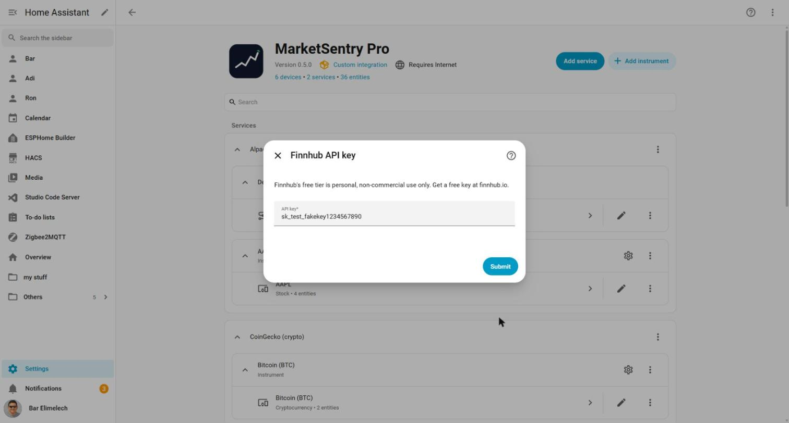

# SEC-001 Finnhub/Alpaca credential fields render as plain visible text, not masked

| | |
|---|---|
| Type | SECURITY |
| Severity | MEDIUM |
| Status | OPEN |
| Issue | [#2](https://github.com/bareli/MarketSentry-Pro/issues/2) |
| Feature | Config flow - Finnhub/Alpaca credentials steps |
| Test case | SEC-06 (new; see *Regression test*) |
| Environment | live (`http://homeassistant.local:8123`) |
| Branch / commit | master @ 1512e7b |
| Detected by | qa-manager (full-cycle live pass, 2026-10-31) |
| Detected | 2026-10-31 |

## Summary

The Finnhub "API key" field and the Alpaca "Key ID"/"Secret key" fields in the config flow's
credentials steps render as ordinary visible text inputs, not password-masked fields. Anyone who
can see the screen (screen share, shoulder surf, a screen recording for a bug report/demo) can
read the key as it's typed or left filled in. Low-to-medium real-world impact (these are personal,
revocable, read-only market-data API keys - Alpaca's are not the trading-API keys, per the
integration's own README), but it's a plain, cheap-to-fix hardening gap in a form whose whole
purpose is collecting a secret.

## Steps to reproduce

1. Settings > Devices & services > MarketSentry Pro > **Add service** > Finnhub (stocks) > Submit.
2. Type any text into the "API key" field.
3. Observe the field's rendering (also confirmable from the DOM: `input.type === "text"`, not
   `"password"`).
4. Same result for Alpaca's "Key ID" and "Secret key" fields on its own credentials step.

## Expected

The field masks input like a password manager would, e.g. dots/bullets, with a reveal toggle if
desired - the standard pattern for any "paste a secret here" field.

## Actual

Plain text, fully readable, confirmed both visually and via `input.type`.

## Evidence



DOM check performed in the same session: `input.type` on the credentials step's text field
returned `"text"`.

## Likely root cause

`custom_components/marketsentry/config_flow.py`'s credential schemas use bare `str` for these
fields:

```python
schema = vol.Schema({vol.Required(CONF_API_KEY): str})
# ...
schema = vol.Schema({
    vol.Required(CONF_KEY_ID): str,
    vol.Required(CONF_SECRET_KEY): str,
    vol.Optional(CONF_FEED, default="iex"): vol.In(["iex", "sip"]),
})
```

HA's `ha-form` renders a bare `str` voluptuous field as a plain text `ha-textfield`. To mask it,
the field needs to be declared with a `selector.TextSelector` using
`selector.TextSelectorConfig(type=selector.TextSelectorType.PASSWORD)` instead of plain `str` -
this is the documented HA pattern other integrations use for exactly this (e.g. API tokens,
passwords) and is a schema-only change, no custom frontend code needed.

## Relevant files

- `custom_components/marketsentry/config_flow.py`: `async_step_finnhub_credentials` (the
  `CONF_API_KEY` schema) and `async_step_alpaca_credentials` (the `CONF_KEY_ID`/`CONF_SECRET_KEY`
  schema).

## Recommended remediation

Replace the bare `str` type with `selector.TextSelector(selector.TextSelectorConfig(type="password"))`
for `CONF_API_KEY`, `CONF_KEY_ID`, and `CONF_SECRET_KEY` in both credential schemas. `selector` is
already imported in this file (`from homeassistant.helpers import selector`, used for
`STEP_PROVIDER_SCHEMA` and the Alpaca `feed` field), so this is a small, low-risk, same-file
change.

## Regression test

None exists yet (config-flow tests need the full `hass` fixture, CI-only on Linux - see
`qa/CLAUDE.md` §1). New test case ID: **SEC-06** - add a config-flow test asserting the rendered
schema's field for `CONF_API_KEY`/`CONF_KEY_ID`/`CONF_SECRET_KEY` is a password-type
`TextSelector`, not a bare `str`.
