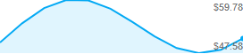
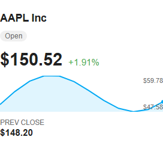
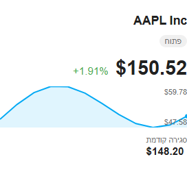
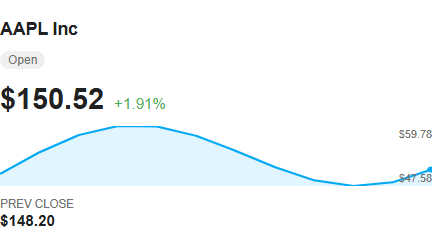

# UX-001 Instrument chart's min-range label overlaps the sparkline curve

| | |
|---|---|
| Type | UX ISSUE |
| Severity | MEDIUM |
| Status | VERIFIED - closed [#4](https://github.com/bareli/MarketSentry-Pro/issues/4) |
| Issue | [#4](https://github.com/bareli/MarketSentry-Pro/issues/4) |
| Screen | `marketsentry-instrument-card` detail view - richer chart (area fill, marker dot, min/max range labels) |
| Workflow | Owner glances at a tracked stock/crypto/FX instrument's detail card to read today's range |
| Persona | The owner (Victor), bilingual he/en, viewing a real Lovelace dashboard, often on mobile |
| Viewport | 320x500 (mobile) and 480x500 (desktop card width); reproduced in English LTR, Hebrew RTL, and mirrored-English RTL alike |

## Problem

The new min/max range-label overlay (`.spark-range`, added this session) is absolutely positioned
on top of the sparkline SVG, pinned to the chart's bottom-right corner (`align-items: flex-end`,
`justify-content: space-between`). The sparkline's own low point and its "now" marker dot are also
very often near that same corner, because the marker dot is always the series' last (rightmost)
point. With the realistic mock history already shipped in the Playwright harness, the blue line
and its light-blue area fill pass directly through the `$47.58` minimum-range label, and the
digits sit on top of the stroke/fill rather than beside it. The maximum label (`$59.78`, top-right)
is clear; only the minimum label collides, and it does so in every theme/direction combination
tested - it is not an RTL-specific or narrow-viewport-specific defect, just worse once there is
less horizontal room to separate text from line.

## Why it matters

The whole point of adding min/max range labels this session was to let the owner read a stock's
or coin's recent range at a glance. When the low-end number sits on top of the chart's own stroke
and fill, that's exactly the number that is hardest to read - on a dark background the fill makes
it worse. This isn't a one-off encoding fluke in the mock data: the marker dot (= latest value) is
structurally always at the right edge, and the min label is always pinned to the bottom-right, so
any instrument whose most recent price is also its intraday low (a falling stock, a dropping coin)
will reproduce this every time, which is a common real-world shape, not an edge case.

## Evidence

Captured via the project's own Playwright harness (`card/e2e/harness.html`), same realistic mock
AAPL history used by the existing `card-light`/`card-dark`/`card-rtl` baselines, built from the
`npm run build` output (not hand-edited).

- Mobile 320px, English, close crop on the chart itself - line crosses straight through "$47.58":
  
- Mobile 320px, English, full instrument card:
  
- Mobile 320px, Hebrew + RTL, full instrument card - same overlap, mirrored:
  
- Desktop width (480px card), English - same overlap, slightly more breathing room but still on
  top of the fill:
  

All four were captured in this session against the current `master` build; none are pre-existing
baselines (the project's own `screenshots.spec.js` only asserts the range labels' text content and
count, never their visual position, so Playwright's own suite stays green while this overlap is
present - not a false pass, just a gap the existing test doesn't cover).

## Recommendation

Two independent, low-risk options (either removes the collision; doing both is stronger):

1. Give `.spark-range`'s labels a solid-ish background chip (matching `--card-background-color`,
   small border-radius, ~2px padding) so text stays legible regardless of what's under it - cheap,
   theme-proof, works in both directions without layout math.
2. Compute the min label's vertical anchor from where the series' low point actually falls
   (`sparklineRange`/`sparklineLastPoint` already have the data) instead of a fixed
   `justify-content: space-between`, so when the low point is in the right half of the chart the
   label flips to anchor near the top instead of stacking on top of the line.

Option 1 is the smaller change and is recommended first; option 2 is a genuine visual improvement
if there's appetite for it.

## Kind

`current behaviour is wrong` - the label is unreadable against its own chart's line/fill in the
realistic case, not a matter of taste.

## Prototype

Not offered - the fix is a small, mechanical CSS/positioning change rather than a new workflow or
layout worth mocking up separately; the two evidence images above already show the before state at
both viewports a reviewer would want to compare against an after.
